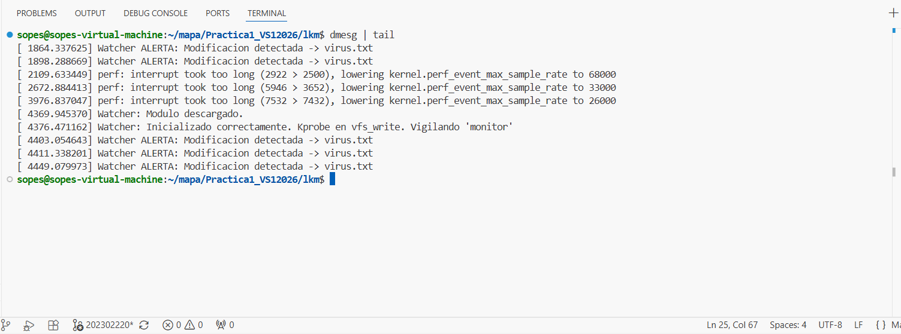
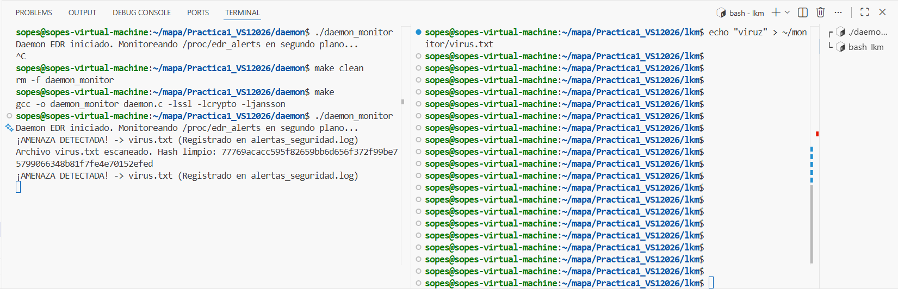

# Informe Técnico: Monitoreo y Seguridad de Archivos

*   **Título del Proyecto:** Monitoreo y Seguridad de Archivos - Sistema EDR Híbrido
*   **Autor:** Enner Esaí Mendizabal Castro
*   **Carnet:** 202302220
*   **Institución:** Universidad de San Carlos de Guatemala (USAC), Facultad de Ingeniería
*   **Fecha:** 5 de Junio de 2026

## 1. Índice
1. [Carátula](#1-carátula)
2. [Índice](#2-índice)
3. [Alcance del Sistema](#3-alcance-del-sistema)
4. [Requisitos Técnicos de Ejecución](#4-requisitos-técnicos-de-ejecución)
5. [Introducción y Arquitectura de la Solución](#5-introducción-y-arquitectura-de-la-solución)
6. [Explicación del Módulo del Kernel (LKM)](#6-explicación-del-módulo-del-kernel-lkm)
7. [Explicación del Daemon (User Space) y Lectura del JSON](#7-explicación-del-daemon-user-space-y-lectura-del-json)
8. [Gestión de Logs y Evidencias (Capturas de Pantalla)](#8-gestión-de-logs-y-evidencias-capturas-de-pantalla)
9. [Conclusiones Técnicas](#9-conclusiones-técnicas)

## 2. Alcance del Sistema
El presente sistema constituye una solución híbrida de Detección y Respuesta en Endpoints (EDR). Su alcance principal es auditar, detectar y reportar en tiempo real la creación o modificación de archivos dentro de un directorio específico y crítico (`/home/sopes/monitor/`). Operativamente, el sistema intercepta las llamadas de escritura a nivel del sistema operativo y las delega a un proceso de usuario para su análisis criptográfico contra una lista negra (Blacklist) de hashes predefinidos. Sus límites de operación dictan que no bloquea la escritura en tiempo real de forma preventiva (no actúa como un IPS en ring 0 absoluto), sino como un centinela reactivo que alerta sobre firmas sospechosas de manera paralela a la ejecución.

## 3. Requisitos Técnicos de Ejecución
*   **Sistema Operativo:** Linux Mint o Basado en Debian (virtualizado en VMware Workstation).
*   **Hardware Base:** Pc con suficientes recursos para la maquina virtual (4 GB de RAM asignados a la VM).
*   **Librerías y Paquetes de Desarrollo:**
    *   `build-essential` y `linux-headers-$(uname -r)`
    *   `libssl-dev` (para cálculo Hash con OpenSSL).
    *   `libjansson-dev` (para parseo de JSON).
*   **Compilación e Inicialización:**
    1.  Compilar Módulo: `cd lkm && make`
    2.  Instalar Módulo: `sudo insmod watcher.ko`
    3.  Compilar Daemon: `cd daemon && make` (o `gcc -o daemon_monitor daemon.c -lssl -lcrypto -ljansson`)
    4.  Ejecutar Daemon: `./daemon_monitor`

## 4. Introducción y Arquitectura de la Solución
Desde el punto de vista arquitectónico, este sistema está cuidadosamente diseñado para preservar el principio de **Separación de Privilegios** y **Aislamiento de Carga** entre el Kernel Space (Ring 0) y el User Space (Ring 3).

El Módulo de Kernel (`watcher.ko`) se encarga exclusivamente de las tareas que demandan privilegios absolutos: la intercepción profunda de rutinas base VFS. Al restringirse únicamente a la obtención del nombre del archivo, su huella (footprint) en la memoria y ciclos del kernel es mínima. 
Toda la lógica "pesada" —lectura exhaustiva del disco, parseo de configuraciones JSON y operaciones criptográficas SHA-256 densas en CPU— se delega de forma asíncrona al Daemon (Ring 3) mediante un puente de comunicación IPC ligero (`/proc/edr_alerts`).

## 5. Explicación del Módulo del Kernel (LKM)
El módulo implementa la intercepción utilizando `kprobes`, una técnica estándar en la arquitectura Linux paramétrica y segura. 
Mediante la estructura `static struct kprobe kp`, se secuestra dinámicamente el símbolo `vfs_write`. En la función interceptora (`pre_vfs_write`), operamos mediante punteros (`struct file*`). Extraemos el `dentry` analizando en su cadena `->d_parent->d_name.name` si concuerda con la carpeta restringida (`monitor`).

Para notificar al espacio de usuario con máxima eficiencia y evitar pérdida de eventos asíncronos en sistemas multi-núcleo (SMP), se utiliza un mecanismo de banderas y búfer seguro gestionado mediante estructuras `spinlock`, protegiendo la variable `alert_buffer` del riesgo de _race conditions_. Los datos empaquetados cruzan el kernel boundary a través del nodo virtual `/proc` empleando `copy_to_user()` para transferencia blindada.

## 6. Explicación del Daemon (User Space) y Lectura del JSON
El proceso Daemon actúa como el orquestador del Ring 3. Implementa un _polling_ ligero (cada 2 segundos) sobre el nodo virtual `/proc/edr_alerts`. Al obtener el nombre de un archivo notificado por el LKM:
1. Reconstruye el path del activo (ej., `/home/sopes/monitor/archivo.txt`).
2. Invoca el motor criptográfico a través de la API `EVP` de OpenSSL (específicamente optimizada con `EVP_DigestInit_ex` y variantes de hardware nativas del CPU), calculando el hash en modalidad binaria y transformándolo a su equivalencia local Hex.
3. Se invoca a la biblioteca Jansson (`json_load_file`), abriendo `blacklist.json` en memoria de manera aislada. Recorre el arreglo JSON en búsqueda asíncrona para hallar la correspondencia unívoca.

## 7. Gestión de Logs y Evidencias (Capturas de Pantalla)
El sistema divide su auditoría en dos vectores cruciales para un análisis forense:
1. **Ring 0 Logs:** Registrados localmente por la API `printk()` (visible por `dmesg`). Proporciona evidencia determinista del Kernel sobre la ocurrencia de la intercepción asincrónica.
2. **Ring 3 Logs Locales:** En el archivo `alertas_seguridad.log`, anexando estampas de tiempo, la ruta detectada y el hash calculado en texto claro.


*(Descripción: Evidencia local del secuestro kprobe detectando alteración).*


*(Descripción: Daemon validando e identificando exitosamente el hash).*

## 8.1 Guía de Pruebas y Verificación del Sistema

A continuación, se detalla un tutorial paso a paso para ejecutar el proyecto e inyectar pruebas a través de la consola, validando la funcionalidad de detección del EDR.

### Paso 1: Compilación y Ejecución de los Componentes
Para inicializar el sistema correctamente, se emplearán dos terminales distintas, manteniendo separados el entorno del kernel y el espacio de usuario.

*   **Terminal 1 (Kernel):** Esta terminal se utilizará para compilar y cargar el módulo interceptor.
    ```bash
    cd lkm
    make
    sudo insmod watcher.ko
    ```

*   **Terminal 2 (Daemon):** Esta terminal se utilizará para compilar e iniciar el orquestador que analiza los archivos.
    ```bash
    cd daemon
    make
    ./daemon_monitor
    ```

### Paso 2: Simulación de Amenazas (Archivos Maliciosos)
Con el Daemon en ejecución, abriremos una **tercera terminal** para inyectar archivos directamente en el directorio monitorizado (`/home/sopes/monitor/`) utilizando el comando `echo`.

Ejecute los siguientes comandos, que generan archivos cuyos hashes exactos coinciden con nuestra lista negra (Blacklist):

1. **Ransomware:**
   ```bash
   echo "Encrypting all user files..." > ~/monitor/Simulated.Ransomware.Encryptor.txt
   ```
2. **Adware:**
   ```bash
   echo "Displaying unwanted ads" > ~/monitor/Simulated.Adware.Popup.txt
   ```
3. **Keylogger:**
   ```bash
   echo "Logging keystrokes silently" > ~/monitor/Simulated.Keylogger.Basic.txt
   ```

**Salida Esperada en la Terminal 2 (Daemon):**
En la consola del Daemon se observará una alerta roja (o destacada) indicando la correlación de la amenaza:
`¡AMENAZA DETECTADA! -> [Nombre del Archivo] | [Descripción del JSON] (Registrado en alertas_seguridad.log)`

### Paso 3: Pruebas de Archivos Seguros (Comprobación de Falsos Positivos)
El sistema está diseñado para ignorar de forma segura archivos legítimos que no figuren en la base de datos de amenazas, evitando falsos positivos.

Para validar esto, ejecute los siguientes comandos:

1. **Archivo inofensivo:**
   ```bash
   echo "Hola mundo, esta es una prueba segura" > ~/monitor/saludo.txt
   ```
2. **Simulación de amenaza modificada** (se altera sutilmente el contenido original para cambiar por completo el hash criptográfico calculado):
   ```bash
   echo "Logging keystrokes sildfdently" > ~/monitor/Simulated.Keylogger.Basic.txt
   ```

**Salida Esperada en la Terminal 2 (Daemon):**
Dado que estos hashes no figuran en ninguna firma de la `blacklist`, el sistema los marca como limpios:
`Archivo [Nombre] escaneado. Hash limpio: [Hash SHA-256 Calculado]`

## 9. Conclusiones Técnicas
**¿Por qué es un error arquitectónico leer/parsear archivos JSON y calcular hashes criptográficos pesados directamente dentro del espacio del kernel?**

Migrar el parseo JSON, la lectura intensiva de disco para SHA-256 o el manejo libre de memoria directamente al Ring 0 sería catastrófico a nivel de diseño por las siguientes razones ineludibles:

1. **Gestión de Memoria y Paginación (_Page Faults_):** El kernel space no admite latencias imprevistas o Fallos de Página incontrolados. La biblioteca Jansson (y parsear JSON en general) requiere operaciones dinámicas intensas (`malloc`, árboles de nodos). El kernel posee recursos escasos (`kmalloc` / `vmalloc` estrictos) y su agotamiento desencadenaría invariablemente escenarios críticos (Kernel Panic - OOM).
2. **Bloqueo del Planificador (Scheduler Deadlocks):** Realizar rutinas matemáticas pesadas (criptografía de megabytes) en el macro interrumpe la ejecución del Kernel y sus tics (`jiffies`), degradando la reactividad total del sistema operativo. Al delegar el SHA-256 al User Space, se garantiza que el SO gestione los hilos criptográficos a través del _Completely Fair Scheduler (CFS)_ regular de usuario.
3. **Violación del _Least Privilege Principle_:** Si una rutina de manejo de JSON dentro de LKM llegase a poseer una vulnerabilidad (ej. _Buffer Overflow_), se concedería un ataque a nivel Super-Supervisor (Ring 0) con control absoluto del Hypervisor o hardware físico, a diferencia de abortar un hilo menor en modo usuario sin crashear la estación.
