# Manual de Usuario: Dashboard EDR Híbrido

**Nombre:** Enner Esaí Mendizabal Castro
**Carnet:** 202302220
**Curso:** Sistemas Operativos 2
**Institución:** Universidad de San Carlos de Guatemala (USAC)

Este documento explica de forma detallada cómo inicializar, configurar y utilizar el Dashboard Web del Sistema EDR Híbrido, tanto para usuarios administradores como para usuarios estándar.

---

## 1. Introducción
El presente manual de usuario tiene como finalidad principal proporcionar una guía paso a paso sobre el uso y funcionamiento del Dashboard Web del Sistema Integral de Monitoreo y Seguridad (EDR). Está diseñado para ayudar tanto a los administradores del sistema como a los usuarios comunes a comprender e interactuar con la plataforma de manera eficiente y segura, garantizando el aprovechamiento total de sus capacidades de monitoreo y detección de amenazas.

## 2. Alcance del Sistema
El EDR Híbrido desarrollado abarca:
- **Monitoreo en tiempo real** de métricas críticas de memoria y paginación extraídas directamente del kernel de Linux.
- **Detección proactiva** de creación y modificación de archivos en un directorio específico (`/home/sopes/monitor`) evaluando cada archivo contra una base de datos local de firmas (SHA-256).
- **Gestión de procesos** mediante la lectura, terminación (SIGKILL) y análisis detallado de procesos por PID.
- **Trazabilidad** mediante un registro histórico persistente de alertas de seguridad y archivos analizados.
- **Control de accesos** implementando módulos de autenticación PAM integrados de manera nativa con el sistema operativo base.

*El sistema **no** realiza correcciones automáticas de sistema operativo ni limpieza de virus automáticas; todas las mitigaciones severas (como la cuarentena o terminar procesos) requieren confirmación manual del usuario administrador.*

## 3. Requisitos del Sistema

Antes de ejecutar el sistema, es indispensable contar con el siguiente entorno:

- **Sistema Operativo:** Linux (distribución basada en Debian/Ubuntu con Kernel 6.8 modificado ya instalado y en ejecución).
- **Dependencias de C:**
  - `libpam0g-dev` (Para autenticación de usuarios)
  - `libssl-dev` (Para operaciones criptográficas SHA-256)
  - `libjansson-dev` (Para procesamiento y generación de JSON)
- **Entorno Web:** Node.js y `npm` instalados para la gestión del frontend.
- **Grupos del sistema:** Los usuarios deben pertenecer al grupo `admin_user` o `common_user` para poder acceder.

Para instalar las dependencias (si aún no las tienes):
```bash
sudo apt update
sudo apt install -y build-essential libpam0g-dev libssl-dev libjansson-dev nodejs npm
```

---

## Preparación de Usuarios de Prueba

El sistema utiliza PAM para autenticación, por lo tanto se deben crear los grupos y usuarios en el sistema Linux:

### Crear los grupos necesarios (solo si no existen)
```bash
sudo groupadd admin_user
sudo groupadd common_user
```

### Usuario 1: Administrador
```bash
# Si el usuario ya existe (ejemplo: sopes), solo agregarlo al grupo
sudo usermod -aG admin_user sopes
```
- **Usuario:** `sopes`
- **Contraseña:** `1`
- **Rol:** Administrador (acceso completo)

### Usuario 2: Usuario estándar
```bash
# Crear un nuevo usuario estándar para pruebas
sudo useradd -m -s /bin/bash viewer
sudo passwd viewer          # Asignar contraseña, ejemplo: viewer123
sudo usermod -aG common_user viewer
```
- **Usuario:** `viewer`
- **Contraseña:** `viewer123` (o la que hayas asignado)
- **Rol:** Usuario estándar (solo visualización)

### Verificar los grupos
```bash
id sopes    # Debe mostrar: admin_user
id viewer   # Debe mostrar: common_user
```

> **Nota:** Si un usuario pertenece a ambos grupos (`admin_user` y `common_user`), el sistema lo tratará como **administrador**.

---

## Guía de Instalación y Ejecución

### Paso 0: Preparar el directorio de monitoreo
El LKM vigila el directorio `/home/sopes/monitor/`. Debe existir antes de iniciar:
```bash
mkdir -p /home/sopes/monitor
```

### Paso 1: Compilar e Insertar el Módulo del Kernel (LKM)
El módulo intercepta las operaciones de escritura en el directorio de monitoreo.
```bash
cd ProyectoUnico_VS12026/lkm
make
sudo insmod watcher.ko
```
Verificar que se cargó correctamente:
```bash
dmesg | tail -5
# Debe mostrar: "Watcher: Inicializado correctamente. Kprobe en vfs_write. Vigilando 'monitor'"

# Verificar que existe el archivo en /proc
cat /proc/edr_alerts
```

### Paso 2: Compilar y Levantar el Daemon (Backend en C)
El backend procesará las métricas del kernel, el escaneo de archivos y las alertas de seguridad.
```bash
cd ProyectoUnico_VS12026/programa_intermedio
make clean
make
sudo ./daemon_monitor
```
> **¡IMPORTANTE!** Es obligatorio ejecutar con `sudo` ya que PAM requiere permisos elevados para autenticar usuarios.

Deberías ver en la terminal:
```
Iniciando Daemon EDR Híbrido...
[Servidor HTTP] Escuchando en http://0.0.0.0:8080
```

**Dejar esta terminal abierta y abrir una nueva para el paso 3.**

### Paso 3: Levantar el Dashboard (Frontend)
El servidor web servirá la interfaz gráfica al navegador.
```bash
cd ProyectoUnico_VS12026/dashboard
npm install        # Solo la primera vez
npm run dev
```
Deberías ver:
```
  VITE v5.x.x  ready in XXX ms

  ➜  Local:   http://localhost:5173/
  ➜  Network: http://X.X.X.X:5173/
```

### Paso 4: Acceder al Dashboard
Abrir en el navegador: `http://localhost:5173/`

---

## 1. Acceso al Sistema (Login)

El sistema utiliza **PAM (Pluggable Authentication Modules)** para la autenticación. Las credenciales son las mismas que se usan para iniciar sesión en el sistema Linux.

### Credenciales de Prueba

| Usuario   | Contraseña    | Rol             | Permisos                     |
|-----------|---------------|-----------------|------------------------------|
| `sopes`   | *(tu password)*| `admin_user`   | Acceso completo              |
| `viewer`  | `viewer123`   | `common_user`  | Solo visualización           |

El sistema verifica automáticamente a qué grupo pertenece el usuario:
- **`admin_user`** → Acceso completo con controles administrativos.
- **`common_user`** → Acceso de solo visualización.
- Si el usuario no pertenece a ninguno de los dos grupos, **no podrá acceder al sistema** y se mostrará un error 403.

**Alertas generadas:**
- Login exitoso → Alerta **LOW**
- Login fallido → Alerta **MEDIUM**

---

## 2. Métricas Globales

Al iniciar sesión, la pantalla principal muestra las **Métricas del Sistema** en tiempo real, obtenidas directamente desde el Kernel mediante la syscall `sys_get_system_monitor` (462).

### Lo que verás:
- **4 Tarjetas de Resumen:**
  - Memoria Usada
  - Memoria Libre
  - Caché / Swap
  - Fallos de Página (Menores y Mayores)

- **4 Gráficas en Tiempo Real:**
  1. **Uso de Memoria y Swap en el Tiempo** — Línea temporal que muestra el comportamiento histórico.
  2. **Memoria Libre vs. Caché vs. Usada** — Gráfica circular (Doughnut) con la distribución actual.
  3. **Páginas Activas vs. Inactivas** — Visualización del comportamiento de la paginación.
  4. **Fallos de Página Menores vs. Mayores** — Tendencia de page faults del sistema.

- **Tabla Top 20 Procesos** — Los 20 procesos con mayor consumo de memoria, actualizados automáticamente.

### Funciones exclusivas del Administrador:
- **Botón "Métricas Activas/Desactivadas"** — Permite activar o desactivar el monitoreo de métricas del sistema. Genera una alerta LOW (activar) o MEDIUM (desactivar).

---

## 3. Procesos del Sistema

Esta pestaña lista los procesos en ejecución del sistema operativo.

### Funcionalidades para todos los usuarios:
- Tabla paginada (15 procesos por página) con PID, nombre y uso de memoria (en MB y %).
- **Barra de búsqueda en tiempo real** para filtrar por nombre o PID.
- **Paginación** con controles de navegación (Página X de Y).

### Funciones exclusivas del Administrador:
- **Consultar Proceso por PID** — Panel exclusivo para ingresar un PID y obtener la información detallada del proceso directamente desde el Kernel (syscall 464: `sys_get_process_info`).
- **Botón "Matar"** — Envía la señal SIGKILL al proceso seleccionado. Se muestra un **mensaje de confirmación** con el PID y nombre del proceso antes de ejecutar la acción. Genera una alerta **MEDIUM**.
- **Toggle "Escaneo Activo/Inactivo"** — Permite activar o desactivar el escaneo de archivos.

---

## 4. Archivos Analizados

Muestra la lista completa de archivos que han sido escaneados por el sistema de detección.

### Lo que verás:
- **Tarjetas de resumen:** Total de archivos escaneados, archivos limpios y archivos infectados.
- **Tabla de archivos** con:
  - Nombre del archivo
  - Estado: **Benigno** (badge verde) o **Infectado** (badge rojo)
  - Hash SHA-256 del archivo
  - Timestamp de la última modificación

### Funciones exclusivas del Administrador:
- **Toggle "Escaneo Activo/Inactivo"** — Controla si el LKM debe continuar monitoreando archivos.
- **Botón "Cuarentena"** — En cada fila infectada, permite poner el archivo en cuarentena directamente (cambia permisos a 0000). Genera una alerta **HIGH**.

---

## 5. Amenazas Detectadas

Sección dedicada a las amenazas identificadas por el motor de comparación de firmas (SHA-256 vs. blacklist.json).

### Lo que verás:
- Conteo total de amenazas detectadas.
- Para cada amenaza:
  - **Nombre de la firma** (ej. "Simulated.Ransomware.Encryptor")
  - **Archivo afectado** con su nombre
  - **Descripción** de la amenaza
  - **Hash SHA-256** del archivo malicioso
  - **Timestamp** de la detección

### Funciones exclusivas del Administrador:
- **Panel de Actualización de Blacklist** — Permite actualizar la base de datos de hashes malignos:
  1. **Subir archivo JSON**: Selecciona un archivo `.json` desde tu computadora.
  2. **Pegar contenido**: Copia y pega el JSON directamente en el textarea.
  3. El sistema **valida el formato** antes de guardar (cada entrada debe tener `hash` y `descripcion`). Genera una alerta **MEDIUM**.

---

## 6. Alertas de Seguridad

Panel cronológico de todas las alertas generadas por el sistema.

### Código de colores:
- 🔴 **ROJO (HIGH)** — Amenaza crítica: hash malicioso detectado, archivo en cuarentena.
- 🟡 **AMARILLO (MEDIUM)** — Advertencia: inicio de sesión fallido, proceso matado, actualización de BD, monitoreo desactivado.
- 🔵 **AZUL (LOW)** — Informativo: archivo escaneado limpio, monitoreo activado, inicio de sesión exitoso.

Cada alerta muestra:
- Tipo de evento (archivos, sistema, sesión)
- Descripción detallada
- Nivel de severidad
- Fecha y hora exacta

Las alertas se ordenan por las más recientes primero.

---

## 7. Cuarentena de Archivos

### Funciones exclusivas del Administrador:
- **Formulario de cuarentena manual** — Ingresa el nombre de un archivo ubicado en `/home/sopes/monitor/` para revocar todos sus permisos (chmod 0000). Se muestra una confirmación antes de aplicar.
- **Lista de archivos en cuarentena** — Tabla con todos los archivos que han sido bloqueados, mostrando:
  - Nombre del archivo
  - Permisos aplicados (0000)
  - Fecha de la cuarentena

---

## 8. Happy Path (Flujo Principal para Administradores)

A continuación, se presenta el flujo de trabajo típico de un Administrador (`admin_user`) dentro de la plataforma EDR Híbrido:

### Paso 1: Inicio de Sesión (Login)
El administrador ingresa sus credenciales vinculadas al sistema Linux (PAM). Si la autenticación es exitosa, se le otorga acceso total.
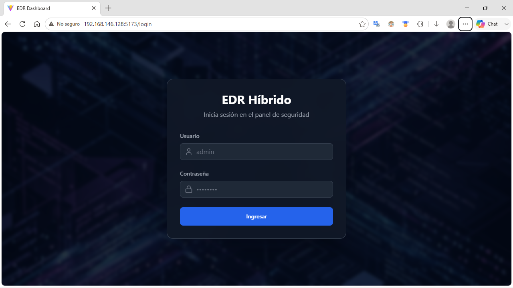

### Paso 2: Análisis de Métricas
Al entrar, visualiza el tablero interactivo de **Métricas Globales**. Aquí puede revisar la tendencia del consumo de RAM y Swap, e identificar si hay alguna anomalía.
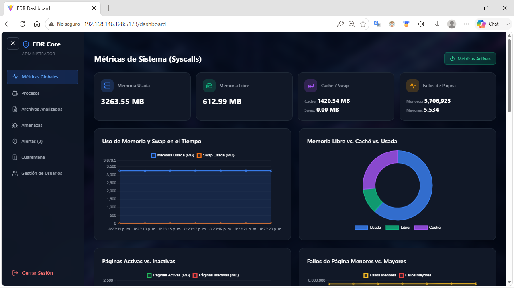

### Paso 3: Revisión de Procesos
Se dirige a la pestaña de **Procesos** para revisar la lista general. Puede utilizar la barra de búsqueda o paginar a través de los procesos activos.
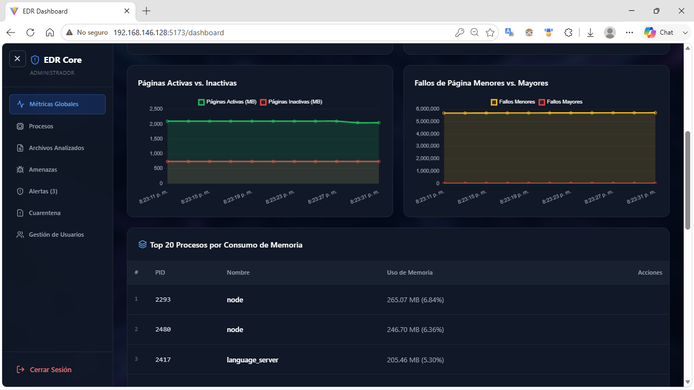

### Paso 4: Terminación de Amenaza Activa
Si identifica un proceso anómalo que consume demasiada memoria, el administrador utiliza el botón **Matar**. El sistema despliega un mensaje de confirmación antes de enviar el comando `SIGKILL` al proceso.
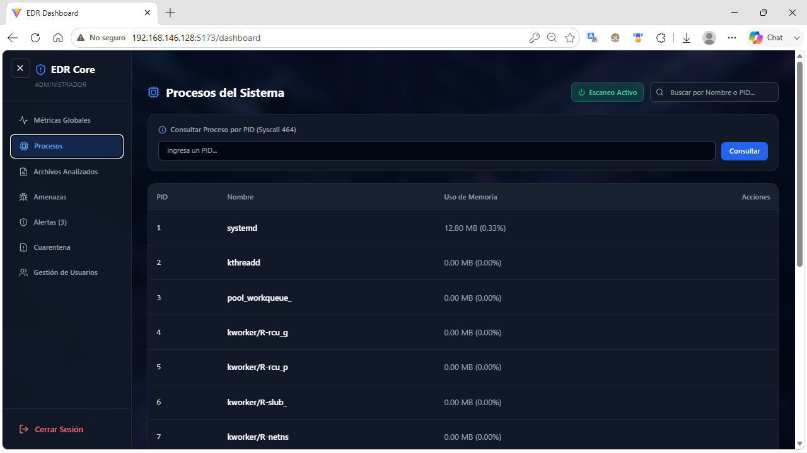

### Paso 5: Investigación Detallada de Procesos
Si requiere analizar un proceso en profundidad sin matarlo inmediatamente, hace clic sobre el proceso o utiliza el buscador por PID para abrir el **Modal Informativo**, el cual extrae los detalles directamente desde el Kernel (Syscall 464).
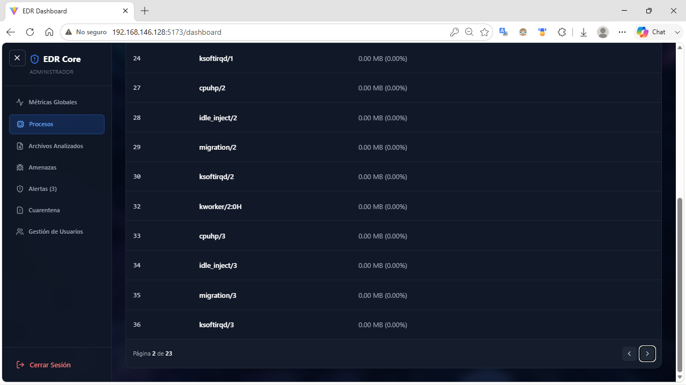

### Paso 6: Verificación de Archivos Analizados
A continuación, revisa la pestaña de **Archivos Analizados** para verificar qué archivos ha detectado el módulo del kernel. En este panel puede observar si algún archivo fue catalogado como *Infectado* de acuerdo con su hash.
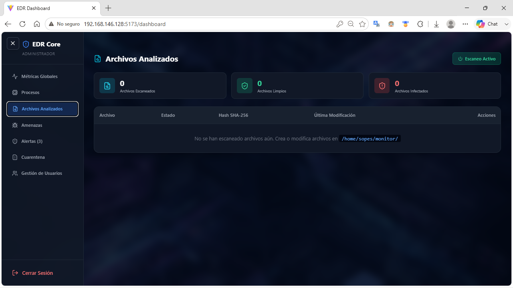

### Paso 7: Revisión de Alertas
Se dirige al **Panel de Alertas** para revisar el registro cronológico del sistema. Aquí verifica si el inicio de sesión previo generó la alerta y visualiza los eventos clasificados por severidad.
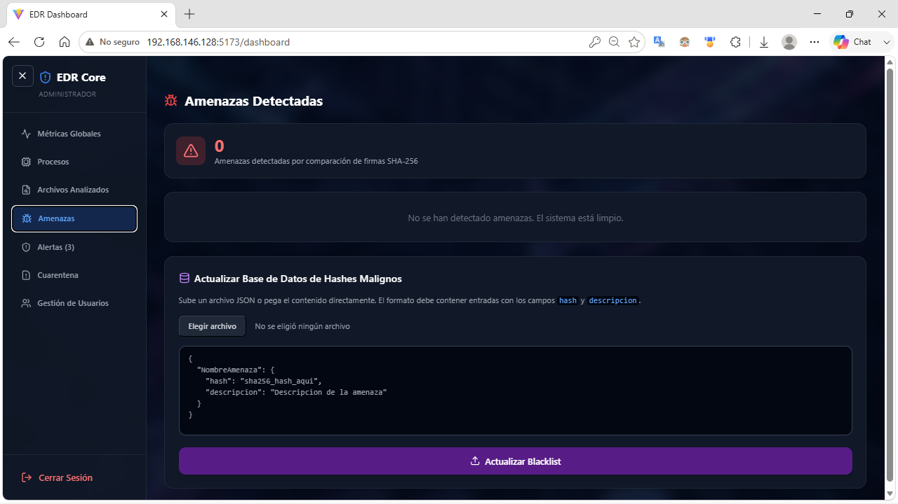

### Paso 8: Visualización de Amenazas Detectadas
Visita el módulo de **Amenazas** para ver el detalle técnico del ransomware o malware detectado, y decide si es oportuno cargar una nueva versión del archivo `blacklist.json` con firmas actualizadas.
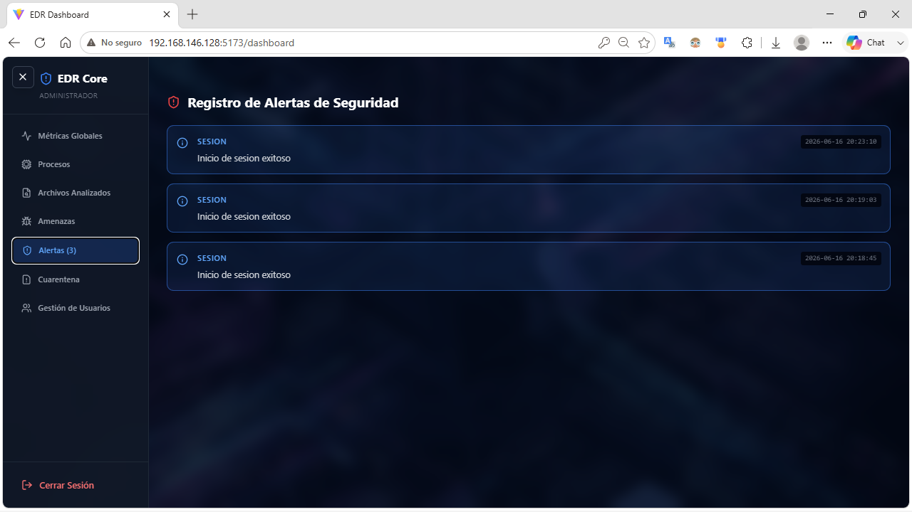

### Paso 9: Gestión de la Cuarentena
En base a los archivos infectados, el administrador aísla de inmediato el archivo utilizando el panel de **Cuarentena**, revocando sus permisos e impidiendo que el archivo sea ejecutado o leído por el sistema operativo.
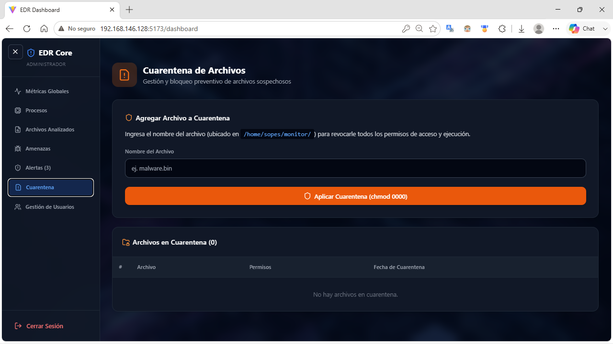

### Paso 10: Administración de Usuarios
Finalmente, el administrador concluye su labor otorgando acceso a un nuevo analista mediante la pestaña **Gestión de Usuarios**, completando un registro rápido que crea al usuario directamente en el SO.
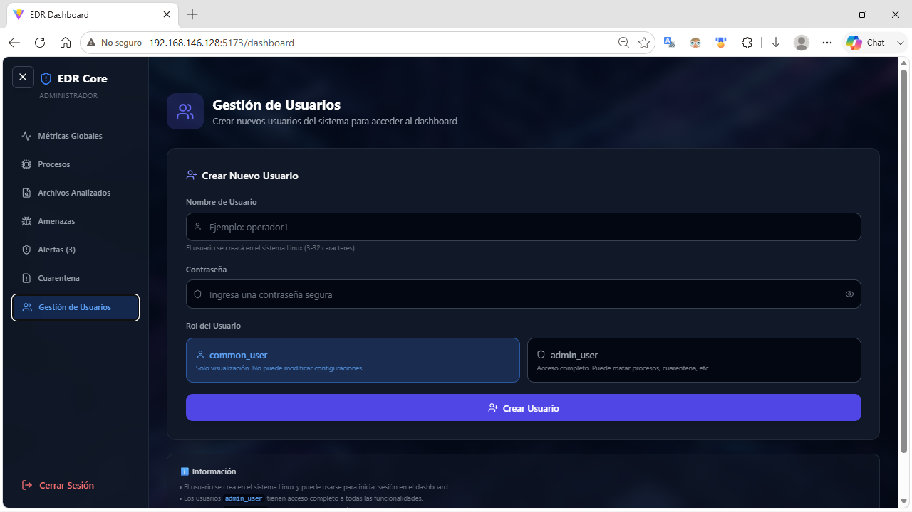

---

## 9. Happy Path (Flujo Principal para Usuario Común)

A continuación, se presenta el flujo de trabajo de un Usuario Estándar (`common_user`), enfocado en la visualización y análisis de datos sin privilegios de modificación:

### Paso 1: Inicio de Sesión
El usuario estándar (`viewer`) inicia sesión usando sus credenciales de Linux.
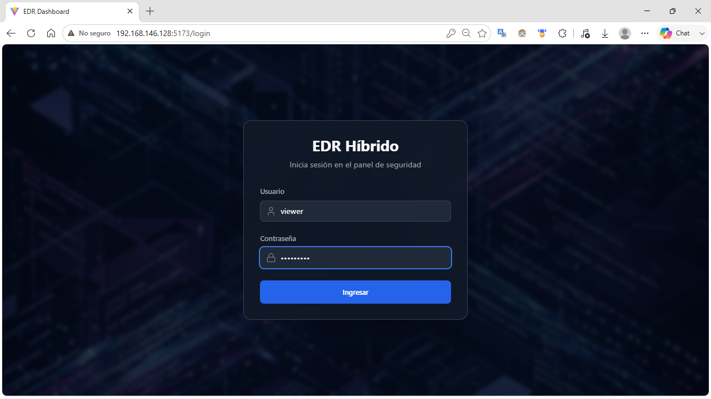

### Paso 2: Análisis de Métricas
El usuario tiene acceso al panel principal de métricas, donde visualiza el estado actual de la memoria y la CPU, además del Top 20 de procesos por memoria, pero **sin la capacidad de detener el monitoreo global ni de matar procesos**.
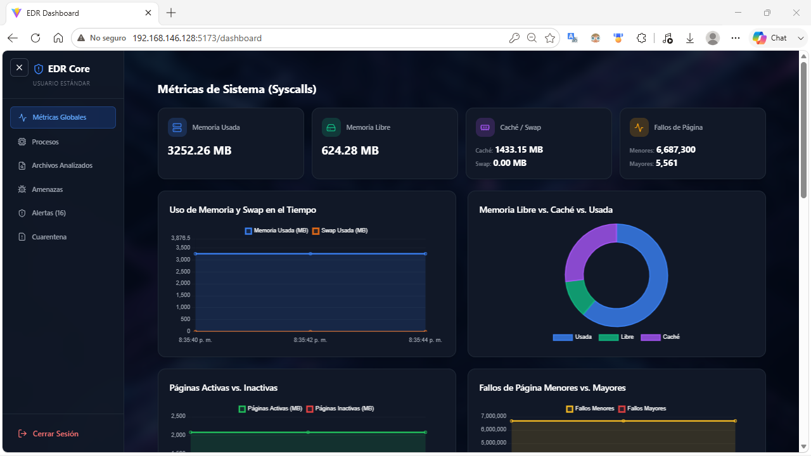

### Paso 3: Exploración de Procesos
En la sección de procesos, el usuario puede buscar y listar todos los procesos en ejecución, pero **no verá la opción de matar un proceso ni el panel para consultar PIDs específicos de forma manual**.
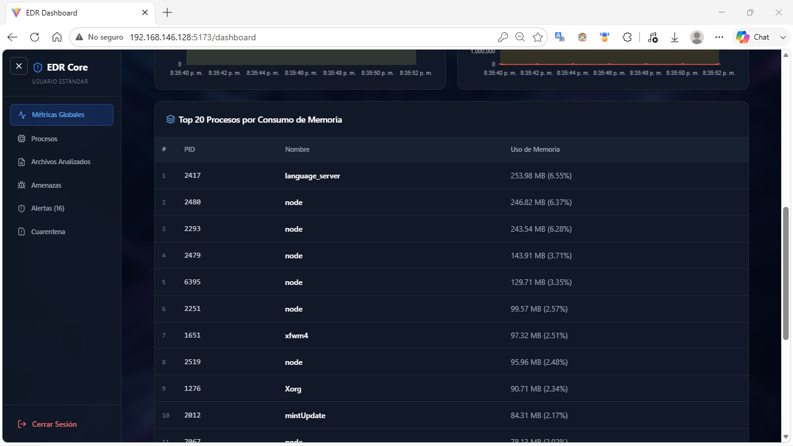

### Paso 4: Revisión de Archivos Analizados
El usuario accede al historial de archivos analizados por el LKM, observando cuáles están infectados o benignos, **sin poder moverlos a cuarentena ni detener el escaneo global**.
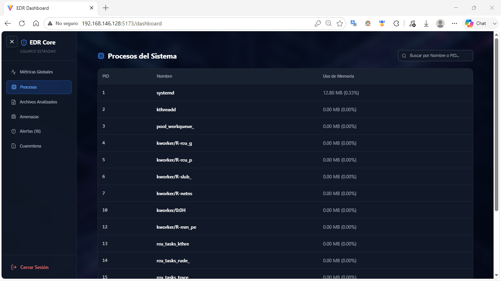

### Paso 5: Registro de Alertas
El usuario visualiza de forma segura la bitácora de eventos del sistema (alertas bajas, medias y críticas) para realizar auditorías o reportes de seguridad.
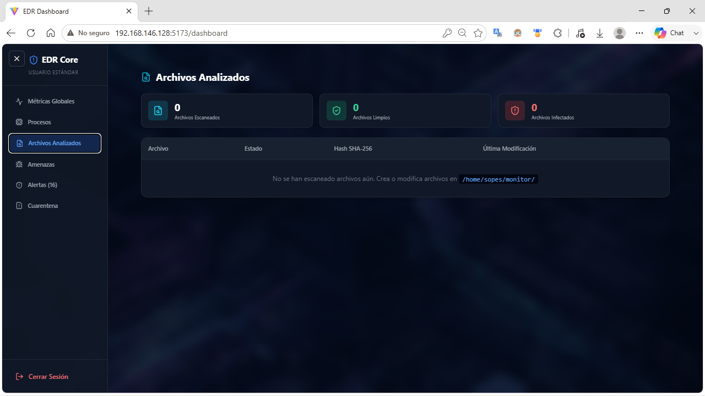

### Paso 6: Análisis de Amenazas
Revisa el detalle técnico de las amenazas y virus detectados, **sin contar con el panel para subir o actualizar la base de firmas** (`blacklist.json`).
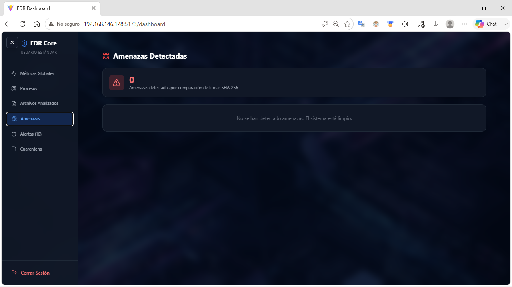

### Paso 7: Accesos Denegados (Cuarentena y Usuarios)
Si el usuario intenta navegar a los módulos administrativos (como la gestión de Cuarentena o la creación de usuarios), el sistema le mostrará un mensaje claro indicando que carece de los permisos necesarios.
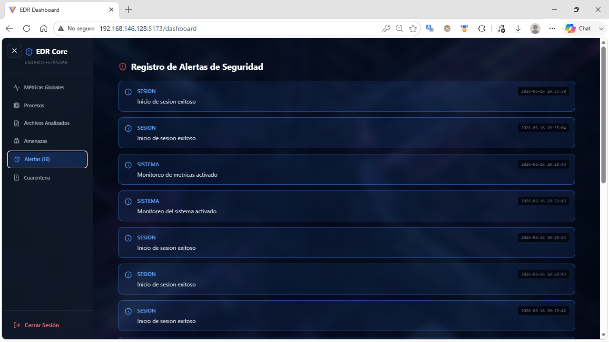
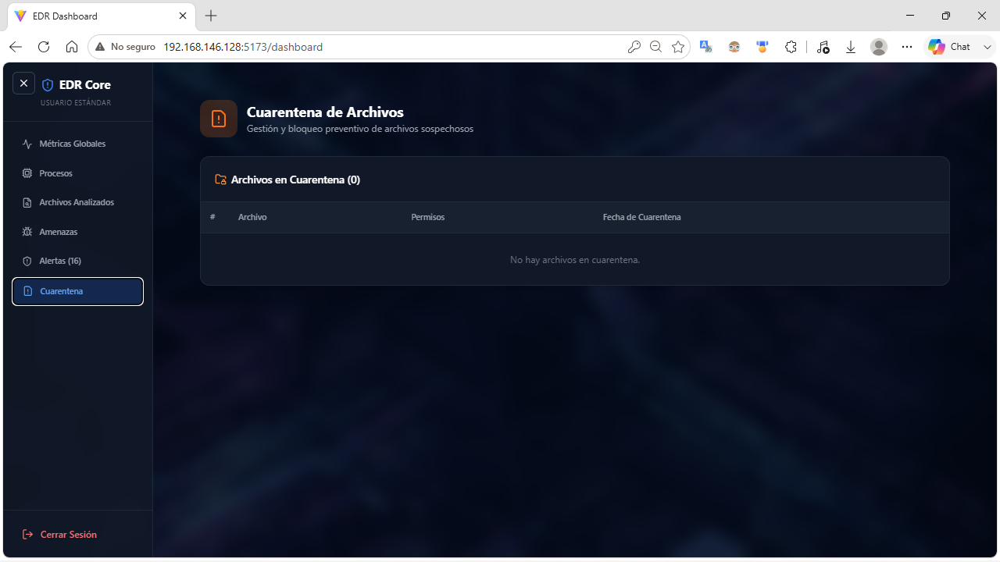

## Diferencias entre Roles

| Funcionalidad | Administrador | Usuario Estándar |
|---|:---:|:---:|
| Ver métricas del sistema | ✔ | ✔ |
| Ver procesos activos | ✔ | ✔ |
| Ver alertas | ✔ | ✔ |
| Ver archivos analizados | ✔ | ✔ |
| Activar/desactivar escaneo de archivos | ✔ | ✘ |
| Activar/desactivar métricas del sistema | ✔ | ✘ |
| Actualizar base de datos de hashes | ✔ | ✘ |
| Consultar proceso por PID | ✔ | ✘ |
| Matar un proceso | ✔ | ✘ |
| Poner archivo en cuarentena | ✔ | ✘ |

---

## Pruebas de Detección

Para probar el sistema de detección de amenazas, hay 6 archivos de prueba precreados en `ProyectoUnico_VS12026/test/malware/`:

| Archivo | Amenaza | Hash (SHA-256) |
|---|---|---|
| `Simulated.Adware.Popup.txt` | Simulated.Adware.Popup | `470EED5B...` |
| `Simulated.Keylogger.Basic.txt` | Simulated.Keylogger.Basic | `97C80B05...` |
| `Simulated.Ransomware.Encryptor.txt` | Simulated.Ransomware.Encryptor | `E29A876B...` |
| `Simulated.Spyware.Tracker.txt` | Simulated.Spyware.Tracker | `3B42566A...` |
| `Simulated.Backdoor.Listener.txt` | Simulated.Backdoor.Listener | `BAA023F8...` |
| `Simulated.Worm.Spreader.txt` | Simulated.Worm.Spreader | `CF3D33E4...` |

### Copiar archivos maliciosos al directorio monitoreado:

> **IMPORTANTE:** Todos los comandos de copia deben ejecutarse desde la carpeta raíz del proyecto: `/home/sopes/mapa/`

```bash
# Navegar al directorio raíz del proyecto
cd /home/sopes/mapa

# Copiar un archivo malicioso al directorio monitoreado
cp ProyectoUnico_VS12026/test/malware/Simulated.Ransomware.Encryptor.txt /home/sopes/monitor/

# Crear un archivo inofensivo para comparar
echo "Archivo de prueba seguro" > /home/sopes/monitor/saludo.txt
```

### Lo que debería ocurrir:
1. El LKM detecta la escritura en `/home/sopes/monitor/`.
2. El daemon lee el nombre del archivo desde `/proc/edr_alerts`.
3. El daemon calcula el SHA-256 del archivo y lo compara con `blacklist.json`.
4. Si el hash coincide → se genera una alerta **HIGH** y el archivo aparece como **infectado**.
5. Si el hash no coincide → se genera una alerta **LOW** y el archivo aparece como **benigno**.

### Descargar y cargar el LKM:
```bash
# Descargar (desactivar monitoreo de archivos)
sudo rmmod watcher

# Recargar (activar monitoreo de archivos)
cd /home/sopes/mapa
sudo insmod ProyectoUnico_VS12026/lkm/watcher.ko
```

---

## Detención del Sistema

Para detener el sistema de forma ordenada:

1. **Detener el Frontend:** Presionar `Ctrl+C` en la terminal del dashboard.
2. **Detener el Daemon:** Presionar `Ctrl+C` en la terminal del daemon.
3. **Descargar el LKM:**
```bash
sudo rmmod watcher
```

---

## Guía Rápida para Calificación (Paso a Paso)

Esta sección proporciona los comandos exactos y el orden de ejecución para demostrar cada funcionalidad del sistema durante la revisión. Cada bloque está pensado para ser **copiado y pegado directamente** en la terminal.

> **Pre-requisito:** Asegurarse de tener 3 terminales abiertas y el navegador listo.

---

### A. Inicialización completa del sistema

**Terminal 1 — LKM:**
```bash
cd /home/sopes/mapa
mkdir -p /home/sopes/monitor
cd ProyectoUnico_VS12026/lkm
make
sudo insmod watcher.ko
dmesg | tail -3
```

**Terminal 2 — Backend (Daemon en C):**
```bash
cd /home/sopes/mapa/ProyectoUnico_VS12026/programa_intermedio
make clean && make
sudo ./daemon_monitor
```

**Terminal 3 — Frontend (Dashboard):**
```bash
cd /home/sopes/mapa/ProyectoUnico_VS12026/dashboard
npm run dev
```

**Navegador:** Abrir `http://localhost:5173/`

---

### B. Probar Login con PAM (Rúbrica: Gestión de Usuarios)

En el navegador:

1. **Login como Administrador:**
   - Usuario: `sopes`
   - Contraseña: `1`
   - ✅ Resultado esperado: Acceso completo, barra lateral con todas las secciones.

2. **Login Fallido (probar rechazo):**
   - Usuario: `sopes`
   - Contraseña: `incorrecta`
   - ✅ Resultado esperado: Mensaje de error "Credenciales inválidas".

3. **Login como Usuario Estándar:**
   - Cerrar sesión primero.
   - Usuario: `viewer`
   - Contraseña: `viewer123`
   - ✅ Resultado esperado: Acceso limitado, sin botones de matar proceso, sin cuarentena, sin gestión de usuarios.

---

### C. Probar Métricas del Sistema (Rúbrica: Syscalls + Dashboard)

Una vez logueado como `sopes` (admin):

1. **Verificar gráficas en tiempo real** — La primera pestaña ("Métricas Globales") debe mostrar:
   - 4 tarjetas con valores numéricos reales (Memoria Usada, Libre, Caché/Swap, Fallos de Página).
   - 4 gráficas actualizándose cada 2 segundos.
   - Tabla con el Top 20 de procesos.

2. **Desactivar métricas** — Pulsar el botón "Métricas Activas" (arriba a la derecha). Las gráficas deben detenerse y generar una alerta **MEDIUM**.

3. **Reactivar métricas** — Pulsar de nuevo. Se genera alerta **LOW**.

---

### D. Probar Detección de Archivos Maliciosos (Rúbrica: LKM + Daemon + SHA-256)

**En la Terminal 3** (o cualquier terminal libre), ejecutar:

```bash
# Copiar un archivo malicioso (su hash coincide con la blacklist)
cd /home/sopes/mapa
cp ProyectoUnico_VS12026/test/malware/Simulated.Ransomware.Encryptor.txt /home/sopes/monitor/
```

**En el navegador:**
- Ir a la pestaña **"Archivos Analizados"** → El archivo debe aparecer como **Infectado** (badge rojo).
- Ir a la pestaña **"Amenazas"** → Debe mostrar la firma "Simulated.Ransomware.Encryptor" con la descripción.
- Ir a la pestaña **"Alertas"** → Debe aparecer una alerta **HIGH**: "Hash malicioso detectado en 'Simulated.Ransomware.Encryptor.txt'".

**Probar con archivo limpio:**
```bash
echo "Este archivo es seguro y no tiene malware" > /home/sopes/monitor/archivo_limpio.txt
```
- En **"Archivos Analizados"** → Debe aparecer como **Benigno** (badge verde).
- En **"Alertas"** → Alerta **LOW**: "Archivo creado/modificado".

---

### E. Probar Cuarentena (Rúbrica: Daemon — Cuarentena chmod 0000)

**En el navegador (logueado como admin):**

1. Ir a **"Archivos Analizados"** → En la fila del archivo infectado, hacer clic en **"Cuarentena"**.
2. Confirmar en el diálogo.
3. ✅ Resultado esperado: Alerta **HIGH** generada: "Archivo puesto en cuarentena".
4. Ir a **"Cuarentena"** → El archivo debe aparecer listado con permisos `0000`.

**Verificar en la terminal:**
```bash
ls -la /home/sopes/monitor/Simulated.Ransomware.Encryptor.txt
# Debe mostrar: ---------- (todos los permisos revocados)
```

---

### F. Probar Terminación de Procesos (Rúbrica: Daemon + sys_kill)

**En la terminal, crear un proceso de prueba:**
```bash
sleep 9999 &
echo "PID del proceso de prueba: $!"
```

**En el navegador (logueado como admin):**

1. Ir a **"Procesos"** → Buscar "sleep" en la barra de búsqueda.
2. Hacer clic en **"Matar"** junto al proceso `sleep`.
3. Confirmar en el diálogo.
4. ✅ Resultado esperado: El proceso desaparece de la lista. Alerta **MEDIUM** generada.

---

### G. Probar Consulta de Proceso por PID (Rúbrica: sys_get_process_info Syscall 464)

**En el navegador (logueado como admin):**

1. Ir a **"Procesos"**.
2. En el panel **"Consultar Proceso por PID"**, ingresar `1` y pulsar "Consultar".
3. ✅ Resultado esperado: Se abre un modal mostrando el nombre (`systemd`), PID (1) y uso de memoria del proceso init.

**También se puede hacer clic** en cualquier fila de la tabla de procesos para consultar su información detallada.

---

### H. Probar Actualización de Blacklist (Rúbrica: Daemon — Gestión BD)

**En el navegador (logueado como admin):**

1. Ir a **"Amenazas"** → Sección "Gestión de Base de Datos (Blacklist)".
2. Pulsar **"Descargar JSON Actual"** para ver la blacklist vigente.
3. Pegar el siguiente JSON en el textarea:

```json
{
  "Test.New.Threat": {
    "hash": "abc123def456",
    "descripcion": "Amenaza de prueba agregada durante la calificacion"
  }
}
```

4. Seleccionar **"Añadir Amenazas (Recomendado)"** y pulsar "Añadir a Blacklist".
5. ✅ Resultado esperado: Mensaje de éxito. Alerta **MEDIUM** generada.
6. Pulsar **"Descargar JSON Actual"** de nuevo para verificar que la nueva entrada fue agregada sin perder las anteriores.

---

### I. Probar el Toggle de Escaneo de Archivos (Rúbrica: Dashboard — Control de escaneo)

**En el navegador (logueado como admin):**

1. Ir a **"Archivos Analizados"** → Pulsar el botón **"Escaneo Activo"** (arriba a la derecha).
2. ✅ Resultado esperado: Cambia a "Escaneo Inactivo". Alerta **MEDIUM** generada.
3. Copiar otro archivo de prueba:
```bash
cp /home/sopes/mapa/ProyectoUnico_VS12026/test/malware/Simulated.Adware.Popup.txt /home/sopes/monitor/
```
4. ✅ Resultado esperado: El archivo **NO** es escaneado mientras el escaneo está desactivado.
5. Reactivar el escaneo → Alerta **LOW** generada. El archivo pendiente será procesado.

---

### J. Probar Múltiples Archivos Maliciosos (Demo completa)

Para una demostración completa del sistema de detección, copiar todos los archivos maliciosos de una vez:

```bash
cd /home/sopes/mapa
cp ProyectoUnico_VS12026/test/malware/Simulated.Adware.Popup.txt /home/sopes/monitor/
cp ProyectoUnico_VS12026/test/malware/Simulated.Backdoor.Listener.txt /home/sopes/monitor/
cp ProyectoUnico_VS12026/test/malware/Simulated.Keylogger.Basic.txt /home/sopes/monitor/
cp ProyectoUnico_VS12026/test/malware/Simulated.Spyware.Tracker.txt /home/sopes/monitor/
cp ProyectoUnico_VS12026/test/malware/Simulated.Worm.Spreader.txt /home/sopes/monitor/
```

✅ Resultado esperado en el dashboard:
- **Archivos Analizados:** 5 archivos nuevos marcados como "Infectado".
- **Amenazas:** 5 amenazas listadas con sus firmas y descripciones.
- **Alertas:** 5 alertas **HIGH** generadas, una por cada hash malicioso detectado.

---

### K. Probar Creación de Usuarios en Tiempo de Ejecución

**En el navegador (logueado como admin):**

1. Ir a **"Gestión de Usuarios"**.
2. Llenar el formulario:
   - Usuario: `analista`
   - Contraseña: `test123`
   - Rol: `common_user`
3. Pulsar "Crear Usuario".
4. ✅ Resultado esperado: Mensaje de éxito.
5. Cerrar sesión y hacer login con `analista` / `test123`.
6. ✅ Resultado esperado: Acceso con rol de usuario estándar (sin opciones admin).

---

### Resumen de Orden Recomendado para Calificación

| Paso | Sección | Demuestra |
|:---:|---|---|
| 1 | A | Inicialización del sistema (LKM + Daemon + Frontend) |
| 2 | B | Login PAM (admin, fallido, usuario estándar) |
| 3 | C | Syscall 462 — Métricas del sistema + gráficas |
| 4 | D | LKM + SHA-256 + Blacklist (archivo malicioso vs limpio) |
| 5 | E | Cuarentena (chmod 0000) |
| 6 | F | Matar proceso (sys_kill + SIGKILL) |
| 7 | G | Syscall 464 — Consulta de proceso por PID |
| 8 | H | Gestión de blacklist (añadir/descargar JSON) |
| 9 | I | Toggle de escaneo (activar/desactivar) |
| 10 | J | Demo completa con todos los archivos de prueba |
| 11 | K | Creación de usuarios en tiempo de ejecución |

